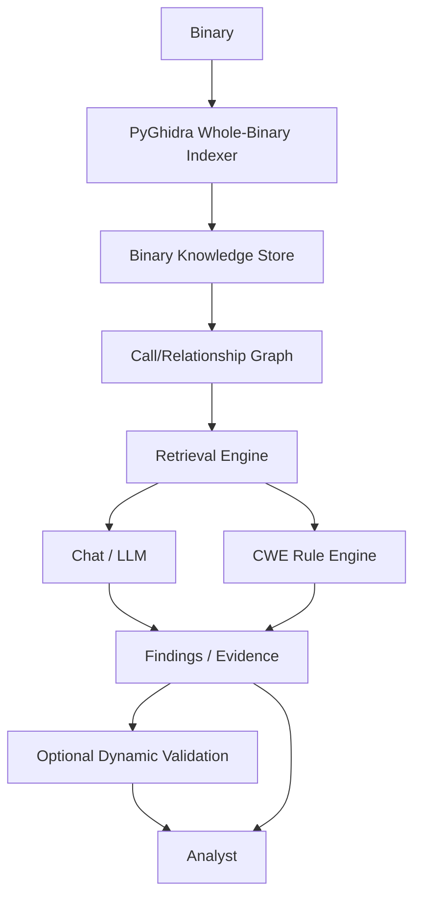

# A.I.R.E. 2.0 architecture

M0 provides the repository foundation; M1 implements read-only whole-binary
indexing. M2 implements SQLite persistence of ProgramIndex. The broader
pipeline below remains planned beyond M4: M3 queries stored CALL relationships,
and M4 selects bounded evidence for future model input without calling a model.
Existing v1 remains a separate per-function Ghidra Java workflow.



## Trust model

Ghidra/PyGhidra produces program facts. Rules produce deterministic findings
where possible. The LLM explains and reasons over evidence; its prose does not
become a program fact or verified vulnerability. The analyst approves changes
and execution. Optional dynamic validation remains a future, isolated and
explicitly authorized step; it is unnecessary for static indexing.

Treat binary strings, decompiled text and model responses as untrusted data.
Store provenance and extraction failures; never fill missing evidence with
invented facts. Distinguish CWE candidates from confirmed findings. Keep
supporting and contradicting evidence visible.

## Responsibilities

| Area | Responsibility | Current status |
| --- | --- | --- |
| ghidra-plugin | Interactive v1 evidence and local model naming | Preserved Java implementation |
| aire.pyghidra | Read-only fact extraction and direct call edges | Implemented M1 |
| aire.knowledge | Records, persistence, retrieval | M2 SQLite persistence and M3 deterministic relationship queries; no semantic retrieval |
| aire.ai | Evidence context and future local model/chat | M4 deterministic context builder; models/chat planned |
| aire.security | Findings and deterministic rules | Finding dataclass only |
| aire.validation | Optional approved isolated validation | Documentation only |
| aire.api | Local service boundary | Planned; no listener |

## Implemented M1 → M2 → M3 → M4 path

```text
Binary
→ Ghidra/PyGhidra
→ ProgramIndex
   ├── BinaryRecord
   ├── FunctionRecord[]
   ├── ArtifactRecord[]
   └── FunctionEdge[]
→ SQLite Binary Knowledge Store
   (binary, functions, artifacts, direct call edges, warnings, analysis metadata)
→ Deterministic Relationship Query Layer (M3)
→ Deterministic Evidence / Context Builder (M4)

Future: → Local LLM / Chat (M5, not implemented)
```

`index_binary(path: Path, options: IndexOptions | None = None) -> ProgramIndex`
is exposed by `aire.pyghidra.indexer`. `ProgramIndex.to_dict()` returns JSON-safe
values. Schema version 1 and extraction timings live in metadata; warnings are
explicit strings. No Ghidra/Java objects escape into these pure dataclasses.

`indexer.py` owns input validation, hashing, JVM/project lifecycle, analysis,
orchestration, and CLI. `extractor.py` reads metadata, functions, decompilation,
assembly, metrics, and artifacts. `graph_builder.py` reads direct calls.
`options.py` validates the small configuration; `knowledge/models.py` contains
pure records and serialization only.

Binary IDs are lowercase file SHA-256. Function IDs append `:<Ghidra entry
address>` including address-space notation. Artifact IDs append a SHA-256 of
canonical JSON `[type, address, value]`. IDs are deterministic for identical
facts; different Ghidra versions/options can change discovered facts. Paths and
timezone-aware analysis timestamps serialize to strings. Missing values use
None, not inferred facts.

Both internal and external function iterators are used: Ghidra's ordinary
`getFunctions()` excludes externals but `getFunctionCount()` includes them.
One decompiler is reused for all non-external functions, with a per-function
seconds timeout. Failures retain the record and add contextual warnings.
Assembly retains complete address/instruction lines up to both configured caps;
`assembly_truncated` reports omitted output. Counts traverse the full body even
when assembly output is bounded or disabled. Branch count means instructions
whose Ghidra FlowType.isJump() is true, excluding calls and returns. Basic block
count means BasicBlockModel blocks intersecting the function body.

STRING artifacts are top-level defined string data recognized by
StringDataInstance. IMPORT artifacts are external function/label symbols, not
all named functions. EXPORT artifacts are symbols at Ghidra external entry
points; these can include loader entry points and are not a literal ELF dynamic
symbol-table dump. CALL edges require a non-computed call instruction and a
Ghidra CALL reference to an exact enumerated function entry. No guessed indirect
targets or extra thunk-to-import edges are synthesized. Indirect callsites and
unresolved direct calls produce warnings.

Read-only means the original binary and existing analyst projects are untouched.
Static analysis necessarily creates facts in the temporary Ghidra program; the
indexer performs no explicit program edits and never saves that program. Program
consumer references, loader results, decompiler, and temporary projects are
closed. An owned headless JVM is reused across calls and shut down with temporary
settings/cache cleanup at process exit. An existing caller-owned JVM is not shut
down. Input hashes are checked on success and failure. Abrupt process termination
cannot guarantee cleanup. The target is never executed or emulated.

Limitations: no single executable entry point is inferred from Ghidra's multiple
external entry points (`BinaryRecord.entry_point` is None); `is_library` is None
because there is no general Function.isLibrary API. Defined strings nested in
structures are not recursively expanded. Shared libraries are not imported for
cross-binary analysis. Decompilation text has a timeout but no text-size cap;
assembly is bounded. This development indexer has no cancellation API or total
binary time limit. Discovery is Ghidra coverage, not proof of all real functions.

## M2 persistence

`aire.knowledge.database.BinaryKnowledgeStore` uses standard-library sqlite3,
without an ORM, global connections, Ghidra imports, or executable-file access.
Construction opens/creates the database and initializes schema version **1**.
`initialize()` is also explicitly callable and idempotent. Unknown/unversioned
existing schemas are rejected, not migrated or overwritten. Store schema version
is independent of the M1 JSON schema version in analysis metadata.

Tables: `schema_metadata`, `binaries`, `functions`, `artifacts`, `function_edges`,
`warnings`, and `analysis_metadata`. All M1 record fields have normal columns,
including `program_name` and `assembly_truncated`. Only metadata values use JSON.
Addresses remain TEXT with their address-space notation. Binary timestamps are
ISO 8601 and reload as datetime; booleans use constrained SQLite integers and
reload as bool (nullable `is_library` remains None). Metadata uses M1 JSON-safe
normalization: Path/datetime/Enum become strings or enum values and tuples become
lists; arbitrary Python object types are not reconstructed. Malformed metadata
JSON raises PersistedDataError rather than returning partial data.

Binary/function/artifact primary keys preserve M1 IDs. Ordinals preserve every
list's order, including repeated warnings and any repeated input edges. Child
rows cascade on binary deletion. Composite edge foreign keys require caller and
callee functions to belong to the same binary; cross-binary relationships are
not supported in M2. PRAGMA foreign_keys is enabled on every store connection.

Explicit indexes cover function address/name, artifact type/value, and edge
caller/callee. Composite UNIQUE/PRIMARY KEY indexes beginning with binary_id
cover per-binary lookups without redundant standalone indexes. Functions also
have a `(binary_id, function_id)` unique key for composite foreign keys.

Each save uses BEGIN IMMEDIATE, deletes the prior snapshot for that binary, bulk
inserts its replacement, and commits once. Any failure rolls back the deletion
and all insertions. No INSERT OR REPLACE is used to steal IDs from another binary.
Repeated saves do not multiply rows, and reanalysis removes stale facts rather
than merging them. Loads use a read transaction for a consistent snapshot.

Public API: `initialize`, `save_program_index`, `load_program_index`, `has_binary`,
`list_binaries`, `delete_binary`, and `close`, plus context manager support.
A missing load raises BinaryNotFoundError. Listing reads BinaryRecord metadata
only. Delete returns bool and never removes the original executable. Context exit
closes the connection; individual save/delete calls have already committed, so
an unrelated later exception in the caller does not undo a completed save.

Use each instance on its creating thread in a single-process/single-writer
workflow. There is no migration framework, concurrent-writer coordination,
analysis history, semantic retrieval, or automatic compaction. M3 adds the
graph-query API separately from persistence.
SQLite's default journaling and lock timeout are retained. Generated databases
belong at temporary/ignored paths, never in version control.

## M3 deterministic relationship queries

`aire.knowledge.retrieval.ProgramQueryService(store)` reads the persisted graph.
`graph.py` holds transient CallRelationship, TraversalNode, CallPath and
FunctionRelationshipSummary dataclasses; none are new database entities. M1/M2
models, schema version 1, extraction, and persistence code remain unchanged.
Each public query reads one transaction snapshot using the store's existing
internal transaction helper, on the same owning thread. No long-lived cache or
additional connection is introduced. Caller/callee queries fetch targeted rows;
rankings aggregate IDs/addresses/counts and load full records only for selected
results. Traversals use repeated targeted queries and a per-query record cache.
No method loads an entire ProgramIndex or writes database rows.

Supported API:

- `find_functions(binary_id, value, by='auto')`: all exact matches, possibly empty.
- `resolve_function(binary_id, function, by='auto')`: exactly one FunctionRecord.
- `get_callers`, `get_callees`: CallRelationship lists with caller, callee,
  exact callsite_address and edge_type.
- `get_callsites(binary_id, source, target)`: CALL relationships between two nodes.
- `get_reachable`, `get_reverse_reachable`: bounded breadth-first discovery.
- `find_call_path`: one bounded shortest path with ordered functions/edges and hops.
- `get_summary`: unique caller/callee counts, incoming/outgoing callsite counts,
  external/thunk flags, and leaf/root status within the stored CALL graph.
- `rank_functions(metric=..., limit=10)`: descending connectivity counts using
  unique_callers, unique_callees, incoming_callsites, or outgoing_callsites.

String selectors match exact IDs, exact stored addresses, or exact current_name;
there is no fuzzy match or address rewriting. Explicit `by='id'`, `'address'`, or
`'name'` selects one field. Auto mode rejects multiple matches across fields.
AmbiguousFunctionError carries the ordered matching records. Unknown binary IDs
raise BinaryNotFoundError; unknown functions raise FunctionNotFoundError (the
explicit multi-match find_functions method returns []). A supplied FunctionRecord
is reread by ID, preserving stored facts instead of trusting caller mutations.
Registered IDs or FunctionRecords from another binary raise BinaryMismatchError;
use explicit name lookup if a local name coincides with a foreign ID.

Only edge_type CALL participates. Exact duplicate relationships are coalesced;
distinct callsites remain separate. Counts use distinct neighbor IDs and distinct
stored callsite addresses per endpoint. Rankings include zero-degree functions.
Self-calls count normally. No importance or behavior is inferred from degree.

Neighbor ordering uses numeric hex offsets within address space, then original
address text/function ID/callsite as deterministic tie breakers. Unparseable
addresses sort lexically. BFS uses that neighbor order and FIFO discovery order;
a visited set includes the start, so self-calls/cycles never repeat nodes. The
start is excluded from traversal output. max_depth defaults to 3 and must be an
integer from 0 through 64 (booleans rejected). A TraversalNode records depth,
predecessor ID and the actual edge. In reverse walks predecessor is toward the
start while the edge retains its original caller→callee direction. Alternative
routes are not enumerated. Paths from a node to itself have zero hops. None from
a path query means no path was found within the bound, not global unreachability.

External functions and thunks remain distinct nodes. They do not need bodies.
The real fixture has multiple exact matches for socket/write/memset, including
PLT-like thunks and EXTERNAL entries. Stored callers attach to specific thunk
addresses; M3 does not synthesize thunk→external edges or indirect targets from
warnings. Root/leaf status therefore describes only the resolved stored graph.

Limits: one binary per query, depth-bounded traversal without a separate node or
time budget, one deterministic shortest route, no pagination, and in-memory
sorting of lightweight ranking rows for numeric address ordering. M3 exposes the
Python API only; no new CLI/server is added.

## M4 deterministic evidence selection

`aire.ai.context_builder.ContextBuilder(store).build(EvidenceRequest(...))`
returns an EvidenceBundle. `knowledge/evidence.py` contains request/result records
and the budgeted renderer. No model, network API, natural-language interpretation,
or Ghidra operation occurs. `chat.py` remains a placeholder. M1–M3 source and the
SQLite schema remain unchanged. The builder uses M3's existing internal snapshot,
exact resolver, relationship and BFS helpers so the whole build sees one read
transaction; it does not nest public query transactions.

EvidenceRequest selects a binary and optional target (exact ID/address/name or
FunctionRecord), with optional explicit target_by. Ambiguity and foreign/unknown
IDs retain M3 errors. A missing target means binary metadata/artifacts only; no
functions are chosen implicitly. include_function controls the target record;
caller/callee flags independently select direct neighbors. traversal_direction
is None by default or forward/reverse/both; max_depth alone does not enable a
walk. Depth 0 disables all graph context. The maximum accepted depth is 64.

Defaults: 20 functions, 50 artifacts, 100 edges; decompiled text 12,000 characters
and assembly 8,000 characters per function; rendered total 60,000 characters.
Strings/imports are enabled, exports disabled. At most 3 global warnings with
2,000 characters each are retained. All optional sections can be disabled and
all numeric limits accept zero. Finite validation ceilings are 1,000 functions,
5,000 artifacts, 10,000 edges, 1,000,000 characters per function text field,
2,000,000 rendered characters, 100 warnings, and 100,000 characters per warning.
Booleans/floats/None are rejected as numeric limits.

EvidenceBundle contains binary metadata, selected FunctionEvidence,
ArtifactEvidence, EdgeEvidence, WarningEvidence, structured Truncation records,
Provenance records, the request summary, and metadata/timings. Every selected
item has a source table, stable source identity, binary/address, and an inclusion
reason. Edge provenance identifies the stored caller/callee/callsite/type tuple.
Edges carry lightweight endpoint IDs/names/addresses, so function-body limits do
not erase callsite identity or duplicate decompiled bodies. A function's stored
metrics/flags remain facts; only requested text excerpts are shortened.

Selection/render priority is deterministic: target first, exact edges directly
touching the target, direct callers, direct callees, shallow traversal evidence,
address-associated imports, then binary artifacts. Each category uses depth,
M3's numeric address ordering and stable IDs as ties. Limits on functions and
edges are independent; edges may reference functions whose bodies were excluded.
M3's visited set prevents repeated traversal nodes; functions, artifacts and
exact edges are deduplicated. One reason/route wins by priority, not semantic
relevance. Only stored resolved CALL edges participate.

No function→string xrefs are persisted. STRING evidence is always labeled
binary-level, even if its address resembles a selected function address. IMPORT
evidence gets higher priority only for an exact address match to a selected
external function, labeled external-address-match; this does not infer a call
or synthesize a thunk link. Other imports and all exports remain explicitly
binary-level. Remaining artifacts sort by STRING/IMPORT/EXPORT, address, ID.
Function-local strings would require a later explicit xref schema extension.

Warnings have no structured function association. Only the existing M1 `Import:`
and `Analysis:` log prefixes are treated as global diagnostics and bounded by
count/text caps. Other warnings are omitted without parsing function names or
instruction addresses into associations. Metadata reports omitted_warning_count,
and a warnings truncation records observed and selected counts.

The renderer appends complete labeled blocks and JSON-quoted stored text, counts
labels/escaping/newlines, and shortens text prefixes incrementally using Python
Unicode slicing. It never renders everything and blindly slices the final
string. Up to 512 characters are reserved for a truncation footer; smaller
budgets use a smaller notice, and budgets below 11 characters may have no room
for a notice at all. Full truncation details remain structured in every case.
Per-field caps, M1 assembly truncation, selection caps, omitted render blocks and
total-character loss all have explicit category/reason/original/retained records.
The footer includes count summaries where they fit. Tiny budgets retain useful
structured metadata/identities even when no corresponding text block fits.

`bundle.render_text()` returns the finalized deterministic text snapshot; timing
values never enter it. `to_dict()` is JSON-safe; `to_dict(include_timings=False)`
allows stable comparisons between builds. Timings cover target resolution, graph
selection, artifact selection, rendering and total construction. Selected bodies,
artifact values and warning text are reduced to their retained rendered excerpts;
source records in SQLite are unchanged. Treat a built bundle as a snapshot and
rebuild rather than mutating its fields expecting cached rendered text to change.

Limitations: max_total_chars bounds rendered content, not the entire JSON bundle
or its retained metadata/identities. M3 candidate walks remain depth-bounded and
can inspect more functions than the final selection cap; no separate scan/time
budget is provided. Artifact ordering inspects matching binary-level identifiers
before fetching selected values. No token-budget estimator or CLI is included.

Not implemented: natural-language query parsing, LLM/chat reasoning, semantic
retrieval, CWE engine, CVE matching, taint/data-flow analysis, or dynamic
validation. M5 is planned; selected facts must remain separate from future model
interpretation.
