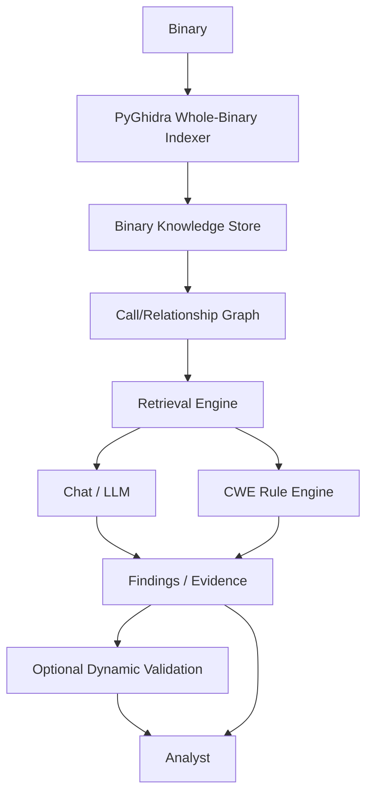

# A.I.R.E. 2.0 architecture

M0 provides the repository foundation; M1 implements read-only whole-binary
indexing. M2 implements SQLite persistence of ProgramIndex. The broader
pipeline below remains planned beyond the knowledge store.
Existing v1 remains a separate per-function Ghidra Java workflow.



## Trust model

Ghidra/PyGhidra produces program facts. Rules produce deterministic findings
where possible. The LLM explains and reasons over evidence; its prose does not
become a program fact or verified vulnerability. The analyst approves changes
and execution. Optional dynamic validation remains a future, isolated and
explicitly authorized step; it is unnecessary for static indexing.

Treat binary strings, decompiled text and model responses as untrusted data.
Store provenance and extraction failures; never fill missing evidence with
invented facts. Distinguish CWE candidates from confirmed findings. Keep
supporting and contradicting evidence visible.

## Responsibilities

| Area | Responsibility | Current status |
| --- | --- | --- |
| ghidra-plugin | Interactive v1 evidence and local model naming | Preserved Java implementation |
| aire.pyghidra | Read-only fact extraction and direct call edges | Implemented M1 |
| aire.knowledge | Records, persistence, retrieval | Records, JSON serialization and SQLite persistence; no semantic retrieval |
| aire.ai | Local Ollama, evidence context, chat | Planned |
| aire.security | Findings and deterministic rules | Finding dataclass only |
| aire.validation | Optional approved isolated validation | Documentation only |
| aire.api | Local service boundary | Planned; no listener |

## Implemented M1 → M2 path

```text
Binary
→ Ghidra/PyGhidra
→ ProgramIndex
   ├── BinaryRecord
   ├── FunctionRecord[]
   ├── ArtifactRecord[]
   └── FunctionEdge[]
→ SQLite Binary Knowledge Store
   (binary, functions, artifacts, direct call edges, warnings, analysis metadata)
```

`index_binary(path: Path, options: IndexOptions | None = None) -> ProgramIndex`
is exposed by `aire.pyghidra.indexer`. `ProgramIndex.to_dict()` returns JSON-safe
values. Schema version 1 and extraction timings live in metadata; warnings are
explicit strings. No Ghidra/Java objects escape into these pure dataclasses.

`indexer.py` owns input validation, hashing, JVM/project lifecycle, analysis,
orchestration, and CLI. `extractor.py` reads metadata, functions, decompilation,
assembly, metrics, and artifacts. `graph_builder.py` reads direct calls.
`options.py` validates the small configuration; `knowledge/models.py` contains
pure records and serialization only.

Binary IDs are lowercase file SHA-256. Function IDs append `:<Ghidra entry
address>` including address-space notation. Artifact IDs append a SHA-256 of
canonical JSON `[type, address, value]`. IDs are deterministic for identical
facts; different Ghidra versions/options can change discovered facts. Paths and
timezone-aware analysis timestamps serialize to strings. Missing values use
None, not inferred facts.

Both internal and external function iterators are used: Ghidra's ordinary
`getFunctions()` excludes externals but `getFunctionCount()` includes them.
One decompiler is reused for all non-external functions, with a per-function
seconds timeout. Failures retain the record and add contextual warnings.
Assembly retains complete address/instruction lines up to both configured caps;
`assembly_truncated` reports omitted output. Counts traverse the full body even
when assembly output is bounded or disabled. Branch count means instructions
whose Ghidra FlowType.isJump() is true, excluding calls and returns. Basic block
count means BasicBlockModel blocks intersecting the function body.

STRING artifacts are top-level defined string data recognized by
StringDataInstance. IMPORT artifacts are external function/label symbols, not
all named functions. EXPORT artifacts are symbols at Ghidra external entry
points; these can include loader entry points and are not a literal ELF dynamic
symbol-table dump. CALL edges require a non-computed call instruction and a
Ghidra CALL reference to an exact enumerated function entry. No guessed indirect
targets or extra thunk-to-import edges are synthesized. Indirect callsites and
unresolved direct calls produce warnings.

Read-only means the original binary and existing analyst projects are untouched.
Static analysis necessarily creates facts in the temporary Ghidra program; the
indexer performs no explicit program edits and never saves that program. Program
consumer references, loader results, decompiler, and temporary projects are
closed. An owned headless JVM is reused across calls and shut down with temporary
settings/cache cleanup at process exit. An existing caller-owned JVM is not shut
down. Input hashes are checked on success and failure. Abrupt process termination
cannot guarantee cleanup. The target is never executed or emulated.

Limitations: no single executable entry point is inferred from Ghidra's multiple
external entry points (`BinaryRecord.entry_point` is None); `is_library` is None
because there is no general Function.isLibrary API. Defined strings nested in
structures are not recursively expanded. Shared libraries are not imported for
cross-binary analysis. Decompilation text has a timeout but no text-size cap;
assembly is bounded. This development indexer has no cancellation API or total
binary time limit. Discovery is Ghidra coverage, not proof of all real functions.

## M2 persistence

`aire.knowledge.database.BinaryKnowledgeStore` uses standard-library sqlite3,
without an ORM, global connections, Ghidra imports, or executable-file access.
Construction opens/creates the database and initializes schema version **1**.
`initialize()` is also explicitly callable and idempotent. Unknown/unversioned
existing schemas are rejected, not migrated or overwritten. Store schema version
is independent of the M1 JSON schema version in analysis metadata.

Tables: `schema_metadata`, `binaries`, `functions`, `artifacts`, `function_edges`,
`warnings`, and `analysis_metadata`. All M1 record fields have normal columns,
including `program_name` and `assembly_truncated`. Only metadata values use JSON.
Addresses remain TEXT with their address-space notation. Binary timestamps are
ISO 8601 and reload as datetime; booleans use constrained SQLite integers and
reload as bool (nullable `is_library` remains None). Metadata uses M1 JSON-safe
normalization: Path/datetime/Enum become strings or enum values and tuples become
lists; arbitrary Python object types are not reconstructed. Malformed metadata
JSON raises PersistedDataError rather than returning partial data.

Binary/function/artifact primary keys preserve M1 IDs. Ordinals preserve every
list's order, including repeated warnings and any repeated input edges. Child
rows cascade on binary deletion. Composite edge foreign keys require caller and
callee functions to belong to the same binary; cross-binary relationships are
not supported in M2. PRAGMA foreign_keys is enabled on every store connection.

Explicit indexes cover function address/name, artifact type/value, and edge
caller/callee. Composite UNIQUE/PRIMARY KEY indexes beginning with binary_id
cover per-binary lookups without redundant standalone indexes. Functions also
have a `(binary_id, function_id)` unique key for composite foreign keys.

Each save uses BEGIN IMMEDIATE, deletes the prior snapshot for that binary, bulk
inserts its replacement, and commits once. Any failure rolls back the deletion
and all insertions. No INSERT OR REPLACE is used to steal IDs from another binary.
Repeated saves do not multiply rows, and reanalysis removes stale facts rather
than merging them. Loads use a read transaction for a consistent snapshot.

Public API: `initialize`, `save_program_index`, `load_program_index`, `has_binary`,
`list_binaries`, `delete_binary`, and `close`, plus context manager support.
A missing load raises BinaryNotFoundError. Listing reads BinaryRecord metadata
only. Delete returns bool and never removes the original executable. Context exit
closes the connection; individual save/delete calls have already committed, so
an unrelated later exception in the caller does not undo a completed save.

Use each instance on its creating thread in a single-process/single-writer
workflow. There is no migration framework, concurrent-writer coordination,
analysis history, semantic retrieval, graph-query API, or automatic compaction.
SQLite's default journaling and lock timeout are retained. Generated databases
belong at temporary/ignored paths, never in version control.

Not yet implemented: semantic retrieval, Python chatbot, CWE engine, CVE matching,
or dynamic validation. M3 will extend deterministic program relationships and
graph queries over persisted facts; it has not started.
