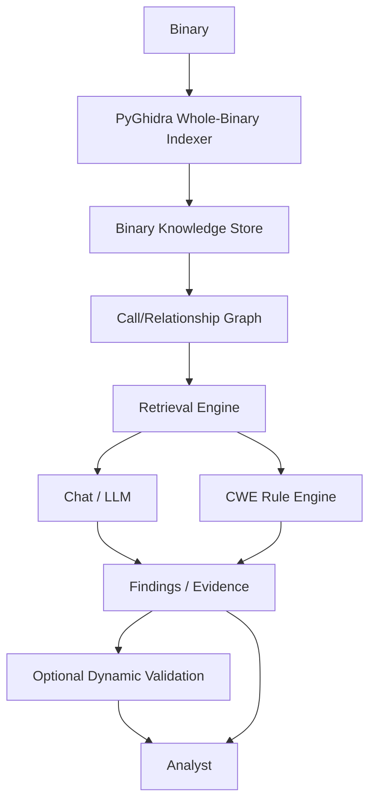

# A.I.R.E. 2.0 architecture

M0 provides the repository foundation; M1 implements read-only whole-binary
indexing. The broader pipeline below remains planned beyond the indexer.
Existing v1 remains a separate per-function Ghidra Java workflow.



## Trust model

Ghidra/PyGhidra produces program facts. Rules produce deterministic findings
where possible. The LLM explains and reasons over evidence; its prose does not
become a program fact or verified vulnerability. The analyst approves changes
and execution. Optional dynamic validation remains a future, isolated and
explicitly authorized step; it is unnecessary for static indexing.

Treat binary strings, decompiled text and model responses as untrusted data.
Store provenance and extraction failures; never fill missing evidence with
invented facts. Distinguish CWE candidates from confirmed findings. Keep
supporting and contradicting evidence visible.

## Responsibilities

| Area | Responsibility | Current status |
| --- | --- | --- |
| ghidra-plugin | Interactive v1 evidence and local model naming | Preserved Java implementation |
| aire.pyghidra | Read-only fact extraction and direct call edges | Implemented M1 |
| aire.knowledge | Records, persistence, retrieval | Records and JSON serialization; no persistence/retrieval |
| aire.ai | Local Ollama, evidence context, chat | Planned |
| aire.security | Findings and deterministic rules | Finding dataclass only |
| aire.validation | Optional approved isolated validation | Documentation only |
| aire.api | Local service boundary | Planned; no listener |

## Implemented M1 path

```text
Binary
→ Ghidra/PyGhidra
→ ProgramIndex
   ├── BinaryRecord
   ├── FunctionRecord[]
   ├── ArtifactRecord[]
   └── FunctionEdge[]
```

`index_binary(path: Path, options: IndexOptions | None = None) -> ProgramIndex`
is exposed by `aire.pyghidra.indexer`. `ProgramIndex.to_dict()` returns JSON-safe
values. Schema version 1 and extraction timings live in metadata; warnings are
explicit strings. No Ghidra/Java objects escape into these pure dataclasses.

`indexer.py` owns input validation, hashing, JVM/project lifecycle, analysis,
orchestration, and CLI. `extractor.py` reads metadata, functions, decompilation,
assembly, metrics, and artifacts. `graph_builder.py` reads direct calls.
`options.py` validates the small configuration; `knowledge/models.py` contains
pure records and serialization only.

Binary IDs are lowercase file SHA-256. Function IDs append `:<Ghidra entry
address>` including address-space notation. Artifact IDs append a SHA-256 of
canonical JSON `[type, address, value]`. IDs are deterministic for identical
facts; different Ghidra versions/options can change discovered facts. Paths and
timezone-aware analysis timestamps serialize to strings. Missing values use
None, not inferred facts.

Both internal and external function iterators are used: Ghidra's ordinary
`getFunctions()` excludes externals but `getFunctionCount()` includes them.
One decompiler is reused for all non-external functions, with a per-function
seconds timeout. Failures retain the record and add contextual warnings.
Assembly retains complete address/instruction lines up to both configured caps;
`assembly_truncated` reports omitted output. Counts traverse the full body even
when assembly output is bounded or disabled. Branch count means instructions
whose Ghidra FlowType.isJump() is true, excluding calls and returns. Basic block
count means BasicBlockModel blocks intersecting the function body.

STRING artifacts are top-level defined string data recognized by
StringDataInstance. IMPORT artifacts are external function/label symbols, not
all named functions. EXPORT artifacts are symbols at Ghidra external entry
points; these can include loader entry points and are not a literal ELF dynamic
symbol-table dump. CALL edges require a non-computed call instruction and a
Ghidra CALL reference to an exact enumerated function entry. No guessed indirect
targets or extra thunk-to-import edges are synthesized. Indirect callsites and
unresolved direct calls produce warnings.

Read-only means the original binary and existing analyst projects are untouched.
Static analysis necessarily creates facts in the temporary Ghidra program; the
indexer performs no explicit program edits and never saves that program. Program
consumer references, loader results, decompiler, and temporary projects are
closed. An owned headless JVM is reused across calls and shut down with temporary
settings/cache cleanup at process exit. An existing caller-owned JVM is not shut
down. Input hashes are checked on success and failure. Abrupt process termination
cannot guarantee cleanup. The target is never executed or emulated.

Limitations: no single executable entry point is inferred from Ghidra's multiple
external entry points (`BinaryRecord.entry_point` is None); `is_library` is None
because there is no general Function.isLibrary API. Defined strings nested in
structures are not recursively expanded. Shared libraries are not imported for
cross-binary analysis. Decompilation text has a timeout but no text-size cap;
assembly is bounded. This development indexer has no cancellation API or total
binary time limit. Discovery is Ghidra coverage, not proof of all real functions.

Not yet implemented: persistence/SQLite, retrieval, Python chatbot, CWE engine,
CVE matching, or dynamic validation. M2 adds SQLite persistence of ProgramIndex;
M3 can extend relationships beyond the direct CALL facts already present in M1.
