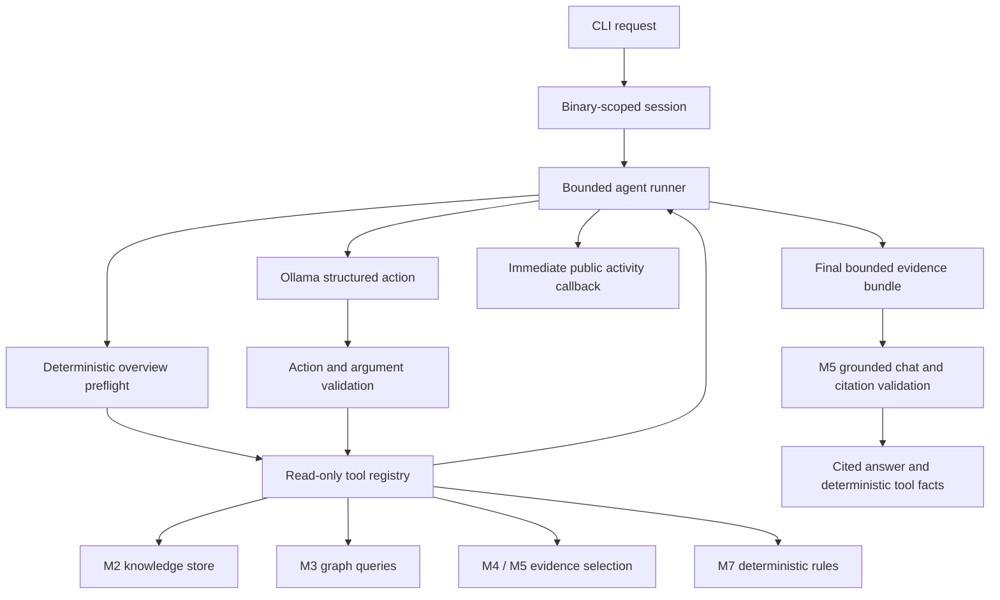

# M8 — read-only A.I.R.E. agent

M8 adds conversational orchestration over the existing persisted analysis. It
does not change the M1 indexer, SQLite schema, graph algorithms, naming rules,
security rules, or Java plugin. The analysis database is opened read-only by the
CLI. Session files are separate, explicitly requested conversation state.

## Architecture and flow



`AgentTools` fixes the binary identity in application code; models cannot switch
binary scope. Exact function lookup, caller/callee queries, shortest bounded
paths, and connectivity ranking delegate to `ProgramQueryService`. Text tools
return bounded stored prefixes with source IDs, addresses and truncation status.
Artifact and evidence tools reuse the existing evidence builders. Security tools
reuse `RuleEngine` and preserve SIGNAL/CANDIDATE qualifications and limitations.

Explicit single stored symbol references are resolved with exact lookup before
planning. Requests mentioning multiple matching functions are left for the model
to disambiguate. The model chooses one JSON tool action or requests an answer. The runner validates
the action, validates arguments against the registry, executes the tool and returns
structured results to the next model call. The provider grammar is derived from
the same tool catalog. Responses remain independently validated if a provider
ignores the schema. Whole recent results enter the bounded planning prompt only
when they fit; oversized results are omitted, not cut into invalid JSON.

If an answer action lacks a requested ranking/caller/callee query, the runner
retrieves that query when the tool budget permits it. Explicit graph questions
return deterministic query results directly, avoiding model-created edge claims.
Missing required graph queries yield a partial result. A caller pronoun without
any current function stops with a warning. These guards do not infer missing
binary facts.

The runner retrieves an explicit final evidence bundle. M5 accepts this bundle
without rebuilding it, validates binary/target scope, constructs its established
citation catalog, and parses the existing structured answer. Agent synthesis
constrains output citation IDs to that catalog, with one reference per claim for
small-model reliability. Behavior explanations require code-bearing function or
call-edge references; binary metadata alone cannot ground behavioral claims.
Existing M5 callers retain their
original default retrieval and response schema. Rank/path/rule/code query results
also appear as deterministic tool facts with their independent provenance.
Requested decompiled text and assembly are displayed from the final evidence
bundle even when model synthesis fails.
These results are not converted into unvalidated model prose.

For whole-binary behavior questions, the runner performs a deterministic preflight
before model synthesis: binary metadata, `rank_application_functions`, direct
callees, then optional imports and M7 findings as the tool budget permits.
The separate application relevance service prefers exact stored `main`, `wmain`,
`WinMain` or `wWinMain`; otherwise stored entry/export paths and recognized runtime
bridges guide a bounded traversal. It supplements paths with metadata and modest
graph scores. Up to two eligible seeds are passed to the M5 selector; the first
three relevance-selected functions receive code admission priority. Runtime
bridges guide traversal without winning behavioral slots through fan-out.
Generic internal names remain eligible. The final `retrieve_evidence` call remains
bounded to six functions, twelve edges, six artifacts, and the configured
character budget. The tool preflight uses the same public activity events,
read-only registry, timeout/cancellation checks, and final tool reservation.
Only the final cited synthesis needs a model call for these requests.

For agent behavioral answers, the provider schema restricts summary and
interpretation citations to visible code-bearing functions and stored CALL
edges. M5 also checks the parsed response, so an ignored provider schema cannot
make a metadata-only behavior claim pass. With no such evidence, synthesis stops
before model inference with `insufficient_evidence`. Ordinary M5 chat retains
its prior selection and citation behavior. These checks establish reference
coverage; they cannot prove that every sentence follows semantically from code.

Defaults: six planning iterations, eight tool calls, 180 seconds, 12,000 planning
characters and 8,000 final evidence characters. One tool slot is reserved for final
evidence retrieval. Lists, edges, text and traversal depth have independent caps;
the serialized tool payload ceiling is 100,000 characters. All limits are finite.
Only registered trusted Python application tools execute; no model code executes.

Malformed actions trigger a warning and grounded synthesis from available evidence.
Unknown tools, invalid arguments and tool exceptions return structured failures;
the loop may continue within its budget. Model failure produces an error/partial
result and retains any deterministic tool facts. Deadline and cancellation hooks
run between operations. Ollama socket timeouts are capped to remaining time.
Synchronous in-flight I/O cannot be interrupted instantly, and socket timeouts do
not provide a hard wall-clock execution guarantee. CLI Ctrl-C returns 130.

## Tool catalog

| Stable name | Arguments | Stored evidence / provenance |
|---|---|---|
| `binary_metadata` | none | Binary identity, hash, format and coverage counts |
| `list_functions` | `limit`, `offset` | Bounded metadata list; no function bodies loaded |
| `get_function` | `function` | Exact ID/name/address; source function row |
| `get_callers` | `function`, `limit` | Direct incoming resolved CALLs with callsites |
| `get_callees` | `function`, `limit` | Direct outgoing resolved CALLs with callsites |
| `get_xrefs` | `function`, `direction`, `limit`, `offset` | Exact outgoing/incoming references; computed call targets remain unresolved |
| `get_function_strings` | `function`, `limit`, `offset` | Exact data references with instruction address, operand, artifact value and provenance |
| `get_thunk_target` | `function`, `max_depth` | Bounded immediate Ghidra thunk chain, direct JMP verification, cycle/depth/ambiguity status |
| `classify_function` | `function` | Derived conservative category, stored flags, loader entry/export and import sources |
| `find_call_path` | `source`, `target`, `max_depth` | Deterministic shortest path within depth 0–8 |
| `rank_functions` | `metric`, `limit` | M3 connectivity counts; no semantic importance claim |
| `rank_application_functions` | `limit` | Likely application logic heuristic: classification, score, reasons, bounded path provenance |
| `get_artifacts` | `kind`, `limit` | STRING/IMPORT/EXPORT, scope and provenance |
| `get_decompiled_text` | `function`, `max_chars` | Stored text prefix and original size |
| `get_assembly` | `function`, `max_chars` | Stored assembly and upstream truncation flag |
| `crosscheck_function` | `function` | Bounded x86 assembly/decompiler observations, local agreement/conflicts and uncertainty |
| `retrieve_evidence` | optional `function`, `max_chars` | M4 target or M5 overview bundle |
| `security_findings` | none | M7 evaluations, evidence, findings and qualifications |

The current catalog contains 18 tools. Function selectors match exact stored IDs,
names or address text. Ambiguous names remain errors. Function-local strings use
stored reference IDs and exact instruction/data addresses; other artifacts retain
binary scope. Missing code or stored
edges does not establish absence of runtime behavior. M3 connectivity rankings
include external and thunk functions; application relevance demotes them.

The relevance score is an ordered heuristic, not ML confidence, a probability,
or proof of source authorship. No model classifies functions before selection.
The extractor leaves `is_library` unset, so this policy ignores that field.
Results are transient; there is no database/schema or M1 change. See
[policy, exact runtime patterns and validation](APPLICATION_RELEVANCE.md).
Overview code excerpts preserve declarations and tails under existing text caps,
with explicit middle-omission markers. GUI requests for assembly retain bounded
assembly; compact prompts share the existing budget across three priority
functions, reserving more of that same budget for code when assembly is requested.
Exact targeted M4 selection remains unchanged. GUI tool/evidence and overview
answer caches include the selection policy version, preserving repeated-query
reuse, binary/fingerprint isolation, streaming and session behavior.

## Public activity

`AgentEvent` serializes `event_type`, UTC ISO timestamp, concise `message`, optional
`tool_name`, `function_id`, `function_name`, `function_address`, and operational
`metadata`. Event types are `agent_started`, `request_received`, `tool_started`,
`tool_completed`, `evidence_found`, `function_selected`, `progress`, `warning`,
`answer_started`, `answer_completed`, `error`, and `agent_finished`.

Metadata allows only iteration/call counts, result counts, success, error/status
codes and truncation flags. The runner does not request, store or emit private
chain-of-thought. It discards malformed model text rather than echoing it in
events. Tool selection, retrieval, selected functions, warnings and final grounded
results are visible. Callbacks run synchronously as operations occur. CLI output
flushes immediately and escapes control characters in binary/model text.

## Session state

`AgentSession` retains the binary ID, selected function ID, up to eight history
messages of 2,000 characters, up to 64 binary-scoped evidence references and four
compact tool outcome summaries. It resolves `it`, `this function`, `that function`
and `current function` to the selected ID. The runner also supplies selection and
bounded history to the action model. Loading a session for another binary fails;
selected IDs are checked against the binary before inference. Overview questions
use overview evidence even when a function was previously selected.

An interactive CLI session stays in memory by default. `--session FILE` persists
it atomically in a separate JSON file and resumes it on the next invocation.
Model summaries remain conversation context; they never become stored binary
facts or security evidence. CLI session paths cannot equal the analysis database
or the selected binary file.

## CLI and Ollama configuration

Install the console entry point into the existing environment:

```bash
aire-server/.venv/bin/pip install --no-deps -e aire-server
export AIRE_OLLAMA_HOST=http://127.0.0.1:11434
export AIRE_OLLAMA_MODEL=qwen2.5-coder:1.5b
export AIRE_OLLAMA_NUM_CTX=4096
aire-server/.venv/bin/aire chat tests/fixtures/simple_elf/aire_test_binary \
  --database analysis.sqlite --session /tmp/aire-session.json
```

The database must already contain an M2 persisted analysis. A binary argument can
be its stored ID, unique stored name, or an existing file with a matching SHA-256.
The command never implicitly launches Ghidra or indexes a binary. It does not
download a model or start Ollama. `AIRE_DATABASE` overrides the default database
path `analysis.sqlite`. The existing `OllamaClient` handles host/model/num_ctx
environment overrides; no model or context allocation is hard-coded in the agent.
`--host`, `--model`, and `--num-ctx` provide explicit overrides.

Without installing the console script:

```bash
aire-server/.venv/bin/python -m aire.agent.cli chat aire_test_binary \
  --database analysis.sqlite --question 'What does this binary do?'
```

Other controls: `--max-iterations`, `--max-tool-calls`, `--timeout`, and
`--evidence-chars`. Exit with `quit`, `exit`, `/quit`, EOF or Ctrl-C. One-shot
requests return 0 on completed synthesis, 1 on partial/error/limit failures.

For initial resource validation, use the installed 1.5B model and `num_ctx=4096`,
serial requests, 3–6 planning steps and 6,000–8,000 evidence characters. Character
bounds are not token bounds; prompt/schema overhead also occupies context. A
larger model/context may need more memory and must be measured on the target
machine. Small models may choose poor tools or fail citation/format checks.

## Tests and validation

Baseline before implementation: **235 tests, 221 passed, 14 skipped**, 5.237 s.
The skipped baseline tests require explicit integration opt-ins.

```bash
aire-server/.venv/bin/python -m unittest discover -s aire-server/tests -v
AIRE_RUN_GHIDRA_TESTS=1 AIRE_RUN_AGENT_LIVE_TESTS=1 \
  AIRE_OLLAMA_HOST=http://127.0.0.1:11434 \
  AIRE_OLLAMA_MODEL=qwen2.5-coder:1.5b AIRE_OLLAMA_NUM_CTX=4096 \
  AIRE_AGENT_DATABASE=/tmp/aire-m8-validation.sqlite \
  AIRE_AGENT_REPORT=/tmp/aire-m8-live.json \
  aire-server/.venv/bin/python -m unittest discover -s aire-server/tests \
  -p test_agent_integration.py -v
```

Unit tests use real SQLite fixtures and mocked model generation. They cover tool
registration/schema isolation, validation, lookups, graph queries, evidence,
read-only behavior, events, session bounds/persistence/isolation, runner limits,
cancellation, malformed/unknown actions, tool/model failures and CLI behavior.
Overview regressions cover the reported early-answer failure, three broad query
forms, a stripped-symbol fallback, no-code/no-call failure, strict rejection of
metadata-only claims, and the tool-call cap.
The opt-in static test indexes both supplied ELF fixtures, verifies their hashes,
uses address lookup on the stripped binary and checks conversational callers.
Live validation records all five requested questions, tool choices, activity,
status, selected function, model/context and answers. A passing live-report test
means the experiment was recorded; inspect per-question statuses to assess model
success. It does not assert every inference succeeded.

The first live run on 2026-10-04 attempted all five questions and produced no
accepted final synthesis: four ChatError failures and one Ollama timeout. Malformed
actions were discarded and bounded retrieval completed for the first four.
This prompted stricter action/citation provider schemas and deterministic tool
fact rendering. A subsequent run completed four structured responses and timed
out on the fifth. Manual review found unsupported metadata-only behavioral
citations and incorrect relationship prose despite valid citation IDs. The final
agent therefore rejects metadata-only behavior grounding and renders explicit
graph answers deterministically. Final results are recorded below.

Earlier milestone regression: **273 tests, 257 passed,
16 opt-in skips**, 6.511 s. Complete static Ghidra regression: **272 tests,
268 passed, four live-model skips**, 611.366 s. This final static run overlapped
local inference; an earlier static run took 73.854 s for 269 cases. One subsequent
failure-classification regression case was added and verified with the default
suite. Editable installation and `aire chat --help` were verified.

The final five-request experiment used the existing environment overrides,
`qwen2.5-coder:1.5b`, `num_ctx=4096`, three planning iterations, five tool calls,
6,000 evidence characters, a 240-second request deadline and a 120-second Ollama
socket timeout. It recorded all five outcomes in `/tmp/aire-m8-live.json` and
retained an indexed database at `/tmp/aire-m8-validation.sqlite`.

| Request | Observed outcome |
|---|---|
| What does this binary do? | Metadata-only behavioral reference rejected with `unsupported_grounding`; no speculative answer shown. |
| Show me the most important functions. | Completed deterministic connectivity ranking: `puts` has five unique callers; `calculate_checksum` three. These are graph metrics, not proven behavioral importance. |
| Why is process_input important? | Exact `process_input` selection at `004012f8` succeeded; Ollama synthesis timed out. An earlier run produced the cited validation/transformation interpretation. |
| What calls it? | Selected function identity was retained, but model action selection timed out in this final run. An earlier live run and static tests retrieved `main -> process_input` at `00401545`. |
| Explain this function using both decompiled code and assembly. | Model selection timed out before code retrieval in the final run; no model explanation was available. Earlier retrieval and deterministic tests establish availability of both tools, but live explanation quality is not validated. |

The final report test passed because all experiment outcomes were recorded, not
because every model request succeeded. Its last result originally carried an
empty partial-result label; the final runner now reports failures without any
retrieved facts as errors, covered by a dedicated regression test. No target
execution or binary modifications occurred. All static integrations passed.

The small model's earlier citation-valid outputs included an invented caller
relationship and a caller/callee direction mismatch. Exact graph answers now
bypass prose synthesis. The remaining code/edge reference guard prevents weak
metadata-only behavior grounding but does not prove semantic entailment of every
model interpretation. The final model/static runs overlapped and active processes
were CPU-intensive; repeat performance measurements with indexing finished and
inference alone before judging ordinary response latency.

On 2026-10-05, the overview grounding correction passed the complete default
suite: **277 tests, 261 passed, 16 opt-in skips**. The targeted Ghidra integration
also passed for the debug and stripped fixture, using a 6,000-character evidence
budget and asserting that both stored code and a CALL edge reached synthesis.
The reported live query was rerun with `qwen2.5-coder:1.5b` and `num_ctx=4096`;
it completed after the deterministic preflight, citing code-bearing functions.
The small model's answer was still broad and included an interpretation that
needs analyst review. The evidence ordering was then refined to give the primary
function's code and internal direct CALL edges prompt priority. Citation checks
continue to establish reference coverage, not semantic proof of generated prose.
The final live rerun of `What does this binary do?` completed with the existing
Ollama overrides and a 6,000-character evidence budget. Its model summary cited
`main` at `0040148d`; interpretations cited the stored `main -> initialize_app`
edge at `004014ac` and `main -> process_input` edge at `00401545`. Imports and
M7 rule statuses were shown as bounded deterministic tool facts. This validates
the reported query path, while broader model reliability remains unproven.

## Change manifest

Added:

- `aire-server/src/aire/agent/__init__.py`
- `aire-server/src/aire/agent/tools.py`
- `aire-server/src/aire/agent/events.py`
- `aire-server/src/aire/agent/session.py`
- `aire-server/src/aire/agent/runner.py`
- `aire-server/src/aire/agent/cli.py`
- `aire-server/tests/test_agent_tools.py`
- `aire-server/tests/test_agent_events.py`
- `aire-server/tests/test_agent_session.py`
- `aire-server/tests/test_agent_runner.py`
- `aire-server/tests/test_agent_cli.py`
- `aire-server/tests/test_agent_integration.py`
- `docs/M8_AGENT.md`

Modified:

- `.gitignore` — ignore generated `aire_server.egg-info`.
- `aire-server/pyproject.toml` — `aire` console entry point.
- `aire-server/src/aire/ai/chat.py` — optional supplied evidence and agent-only citation grammar.
- `README.md` and `aire-server/README.md` — agent capabilities and commands.
- `docs/ARCHITECTURE.md`, `docs/CURRENT_STATE.md`, `docs/ROADMAP.md` — M8 scope and connections.

The six new test files add **38 cases**: 36 deterministic cases and two opt-in
integration/validation cases. Binary fixtures, schema, M1–M4, M6 and M7 source
implementations and the Java plugin are unchanged.

## Example session

This is an illustrative interaction; exact tool choices are model-dependent.

```text
A.I.R.E. Agent
Binary: aire_test_binary
> Why is process_input important?
[AGENT] Request received
[TOOL] get_function: Executing read-only tool
[AGENT] Selected stored function (process_input at <stored address>)
[TOOL] get_callees: Executing read-only tool
[TOOL] retrieve_evidence: Executing read-only tool
[AGENT] Synthesizing grounded answer
A.I.R.E.:
<M5 cited summary, stored facts, separate interpretations and uncertainties>
> What calls it?
[TOOL] get_callers: Executing read-only tool
A.I.R.E.:
<stored caller edges with callsites, plus cited synthesis when accepted>
```

An earlier real live run retrieved this exact stored result:

```text
> What calls it?
[TOOL] get_callers: Executing read-only tool
A.I.R.E.:
main -> process_input at 00401545
```

The final graph-answer renderer returns the stored query result directly. For a
fresh session, first select the function with `Why is process_input important?`;
its exact lookup retains selection even when model synthesis fails. Reproduce
the session against the validation database:

```bash
export AIRE_OLLAMA_HOST=http://127.0.0.1:11434
export AIRE_OLLAMA_MODEL=qwen2.5-coder:1.5b
export AIRE_OLLAMA_NUM_CTX=4096
aire-server/.venv/bin/aire chat aire_test_binary \
  --database /tmp/aire-m8-validation.sqlite --session /tmp/aire-m8-session.json \
  --max-iterations 3 --max-tool-calls 5 --evidence-chars 6000 --timeout 240
```

## Limitations and next milestone

Citation existence is validated; the semantic truth of model prose is not
mechanically proven. Interpretations remain advisory. Uncited or malformed output
is rejected. Model action choice and natural-language pronoun interpretation are
not guaranteed; application selector resolution itself is deterministic. Planning
and evidence truncation can omit useful results. Final M5 synthesis consumes its
explicit bundle; independent tool rankings/paths/rules are rendered as stored
facts alongside it, not merged into M5's model citation catalog.

Function/string xrefs and separate thunk bindings are now available; see
[M9 implementation](M9_IMPLEMENTATION_2026-10-13.md). Indirect-call recovery,
taint analysis, vulnerability confirmation, target execution and automatic edits
remain unavailable.
There is no async hard cancellation, token-budget accounting, semantic search,
multi-agent execution or concurrent use of a SQLite connection.

Recommended next milestone: bounded P-code/CFG analysis and an investigation report,
then evaluate action selection and answer grounding across more binaries/models
and add bounded source/sink facts. Extend deterministic rules only when those facts
provide provenance, with positive and negative controls.

## Adding a tool

Add a trusted, read-only adapter in `AgentTools` that delegates to existing modules.
Register a `Tool(stable_name, description, parameters, callable)` in its entries.
The minimal schema supports nonempty strings, bounded integers, enums, defaults
and nullable selectors; unexpected arguments are rejected. Return JSON-safe data
with binary-scoped IDs, addresses/source tables, scope limitations and truncation
details. Keep payloads under the serialization ceiling and avoid target execution,
database writes or implied provenance. Add deterministic validation, provenance,
failure and read-only tests. The action grammar automatically includes the new
registry entry. Add deterministic rendering when its output is useful outside
M5's final evidence bundle, and update this catalog.
