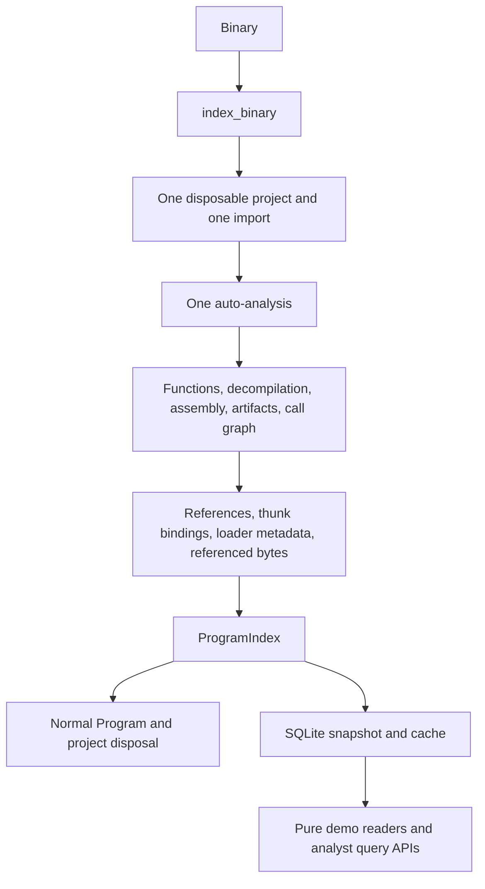

# Integrated reference evidence

Reference collection now runs inside `index_binary()` after call-graph extraction
and before the original analyzed Program is released. One fresh request creates
one disposable project, imports once, and runs auto-analysis once. The existing
functions, decompilation, assembly, artifacts, and direct CALL graph are retained.
No analyzer/decompiler setting is changed, and targets are never executed or
modified. Both layers' SHA-256 integrity checks remain in place.



## Records and extraction

`ProgramIndex` adds default-empty fields at the end of its constructor, preserving
existing positional construction and JSON-safe serialization:

- `references: list[ReferenceRecord]`: stable ID, binary ID, source/destination
  addresses, Ghidra type, operand index, exact source function, exact target entry,
  destination artifact link, source instruction, call/computed/read flags, and
  optional raw bytes encoded as hex.
- `thunks: list[ThunkRecord]`: immediate binding from
  `getThunkedFunction(False)`, source/target addresses and function IDs, observed
  instruction, and whether the binding is independently verified by a direct
  jump flow to that destination.
- `program_info: dict[str, str]`: original Program Information/PDB properties and
  the ELF demo's loaded-memory interpreter and ELF64 little-endian DF_1_PIE facts.

`aire.pyghidra.references.extract_references()` receives the existing Program and
function/artifact lists. It has no project/runtime/import/analysis/decompiler
lifecycle. It visits reference sources in Program memory, including defined-data
sources that have no instruction/function owner. Unknown associations stay null.
Up to eight initialized bytes at READ destinations are retained as raw evidence,
preserving the demos' double-constant checks without embedding a PE address in
the core. The PE demo alone still chooses its hash-pinned constant address.

Computed calls retain their observed raw destination and an explicit indirect
flag, but do not assert a target function. No target is guessed. Existing
`function_edges` and caller/callee queries remain direct-CALL-only. Thunk bindings
are separate evidence and never manufacture CALL edges. The demos retain their
original literal JMP/observed-flow requirement when displaying jump thunks.

`IndexOptions.include_references` defaults to true. Its exact cached-option match
also invalidates historical snapshots whose option maps lack this field. A
snapshot with absent reference facts is not silently accepted by the demo views;
they ask for fresh indexing. Extraction is timed separately as `xrefs` and as
`metadata.reference_extraction_seconds`; current reference-facts format version is 2.
Format v2 leaves computed JMP targets unresolved as well as computed CALL targets.
`analyze_binary()` requires the current integer reference-facts version when
references are requested; older/missing versions trigger fresh static indexing.
Existing v1/v2 SQLite stores remain readable without analysis. Investigation and
reference query views conservatively clear legacy computed-flow function targets
without modifying stored rows; original snapshot loading preserves historical data.

## Persistence and readers

SQLite schema v2 adds `binary_references`, `thunk_relations`, and
`program_information`, with per-binary ordered snapshots, indexes, ownership
foreign keys, and boolean constraints. Save/replacement/deletion remain atomic.
The v1-to-v2 upgrade is transactional and preserves all existing rows. Failed
upgrades roll back. Historical analyses load with default-empty new fields and
require fresh indexing for reference evidence.

Read-only naming/security adapters accept v1 and v2, retain `mode=ro` and
`PRAGMA query_only=ON`, and never initialize/migrate databases. Reference queries
against v1 return no reference records; they do not analyze the target.

`ProgramQueryService` adds:

```python
query.get_function_references(binary_id, function)
query.get_function_referrers(binary_id, function)
query.get_artifact_references(binary_id, artifact_id)
query.get_thunk_bindings(binary_id, function)
```

Existing `get_callers` and `get_callees` keep their semantics. These APIs and the
pure `aire.knowledge.reference_views` helpers read stored evidence without JVM or
target-file access. The three professor demos' `collect_xrefs(index)` functions
now only adapt these views for presentation; they cannot open Ghidra or rerun
analysis. Existing analyst metadata, strings, instructions, thunk paths, and
constant/ABI checks are retained. October 13 added GUI/AI evidence-bundle
references and separate thunk records, citable `XREF`/`THUNK` prompt entries,
and the read-only `InvestigationService`. See
[M9 implementation](M9_IMPLEMENTATION_2026-10-13.md). No generated descriptions
are stored as binary facts.

## Actual ProgramIndex example

The measured PE snapshot contains this reference (projection; IDs abbreviated):

```json
{
  "source_address": "00412653",
  "target_address": "00419b38",
  "reference_type": "DATA",
  "source_function_id": "<binary-sha256>:00412620",
  "target_artifact_id": "<string-artifact-id>",
  "source_instruction": "PUSH 0x419b38",
  "operand_index": 0,
  "is_call": false,
  "is_indirect": false
}
```

Its linked STRING artifact has address `00419b38` and value `"square of integer "`.
This is an observed reference from the integer overload's body, not a match
guessed from decompiler text. Complete IDs are in the benchmark artifact.

## Benchmark

Run from the repository root in a new Python process:

```bash
GHIDRA_INSTALL_DIR="$HOME/tools/ghidra" \
JAVA_HOME=/usr/lib/jvm/java-21-openjdk-amd64 \
PYTHONPATH=aire-server/src \
aire-server/.venv/bin/python scripts/benchmark_integrated_references.py \
  professor_samples/function_overloading/original/FunctionOverloading.exe \
  --output /tmp/aire-integrated-references.json
```

The benchmark performs exactly one forced fresh request, persists its snapshot,
reads the demo presentation data, and then verifies a cache hit and identical
stored demo data. The cache verification cannot invoke indexing. Full precision,
exclusive stage timings, per-function counts, example data, and hashes are in
[INTEGRATED_REFERENCES_BENCHMARK.json](INTEGRATED_REFERENCES_BENCHMARK.json).

| Workflow | Seconds |
|---|---:|
| Before: historical normal cold analysis | 28.655448 |
| Before: historical duplicate xref pass | 10.070201 |
| **Before: combined** | **38.725649** |
| **After: single integrated request plus stored demo view** | **25.579774** |
| After: integrated reference extraction, included above | 0.136145 |
| After: verified cached request, measured separately | 0.027294 |

The integrated measurement includes snapshot serialization/save and normal
Program/project cleanup. Store opening, cache verification, report output, and
process-exit JVM shutdown are outside the fresh total. Before values are from the
recorded profiling run; system load/JIT/OS cache variation means the full elapsed
difference cannot all be attributed to this change. The elimination of the
second import/analysis is directly demonstrated by operation counts.

| Fresh integrated workflow operation | Count |
|---|---:|
| Projects created | 1 |
| Target imports | 1 |
| Auto-analysis calls | 1 |
| Discovered functions | 385 |
| Explicit functions decompiled | 302 |
| Repeated explicit decompilations | 0 |
| Reference extraction passes | 1 |
| References retained | 2,359 |
| Thunk bindings retained | 169 |
| Database saves | 1 |
| SHA-256 reads | 4 |

The original pre-integration functions, assembly, decompilation, artifacts, call
edges, warnings, and metadata matched the recorded baseline after excluding only
timestamps, timers, and the new reference fields/options. The saved/cached whole
snapshot and demo evidence matched exactly. Before and after SHA-256:

```text
before: cfc8c5f031587c721d680d3dd9bd94bbc690667acf8651403fb8c7e70f2fab07
after:  cfc8c5f031587c721d680d3dd9bd94bbc690667acf8651403fb8c7e70f2fab07
```

## Tests

- 12 new unit tests cover the existing-Program extractor, direct call versus
  computed-call behavior, literal and external thunks, string ownership, raw
  bytes, optional failures, serialization/reopen, ownership constraints,
  replacement/deletion, v1 read-only compatibility, transactional migration
  rollback, cache preservation, legacy-option invalidation, and runtime-free
  demo readers.
- Full pure-Python discovery: 411 tests, 389 passed and 22 opt-in tests skipped.
- Four Ghidra integration tests passed, including the new PE/ELF test. Spies
  assert exactly one actual project/loader/analyze call per fresh binary, and
  object identity proves reference extraction receives the very Program passed
  to analyze. Reference facts persist and survive cache hits. Existing indexer,
  database, and cache integration tests also pass.
- Both complete `--full` demo presentations were additionally exercised with
  per-demo operation counters and their original analyst/integrity checks.

## Files changed

- `aire-server/src/aire/pyghidra/references.py` — same-Program evidence extractor.
- `aire-server/src/aire/pyghidra/indexer.py` — extract before normal release.
- `aire-server/src/aire/pyghidra/options.py` — explicit reference option/default.
- `aire-server/src/aire/knowledge/models.py` — typed reference/thunk records and
  additive ProgramIndex fields.
- `aire-server/src/aire/knowledge/database.py` — v2 tables, atomic migration and
  complete persistence/load.
- `aire-server/src/aire/knowledge/retrieval.py` — binary-scoped reference queries.
- `aire-server/src/aire/knowledge/reference_views.py` — runtime-free demo views.
- `aire-server/src/aire/profiling.py` — reference and thunk counters.
- `aire-server/src/aire/security/rule_engine.py` and
  `aire-server/src/aire/ai/naming.py` — read-only v1/v2 compatibility.
- `scripts/demo_function_overloading.py`, `scripts/demoL_function_overloading.py`,
  and `scripts/demo_function_overloading_WINDOWS_backup.py` — remove all duplicate
  project/import/analysis code; consume indexed evidence.
- `scripts/benchmark_analysis_cache.py` — verify a stored demo view after profiling.
- `scripts/benchmark_integrated_references.py` — one-request before/after benchmark.
- `aire-server/tests/test_references.py`,
  `aire-server/tests/test_references_integration.py`, and
  `aire-server/tests/test_database.py` — new coverage and current-schema assertions.
- `aire-server/README.md`, `docs/REFERENCE_FACTS.md`, and
  `docs/INTEGRATED_REFERENCES_BENCHMARK.json` — architecture, reproducibility,
  validation and measured evidence.
