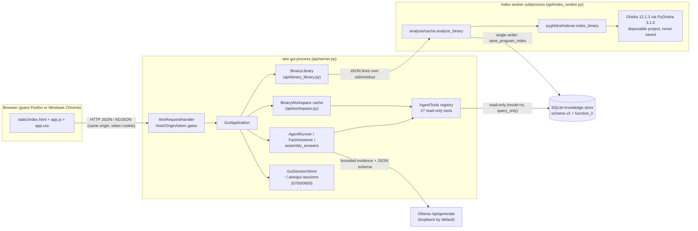
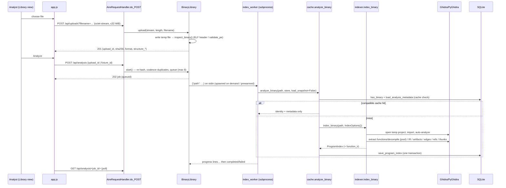
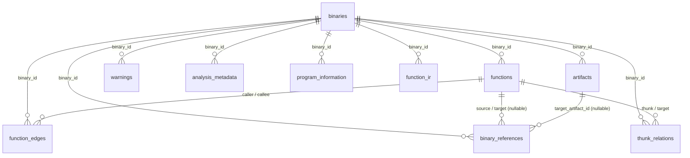
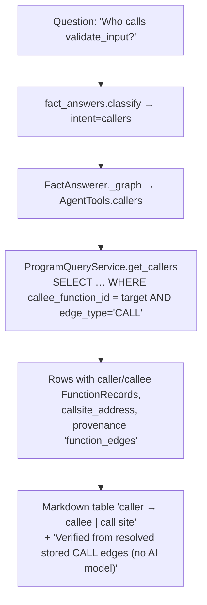
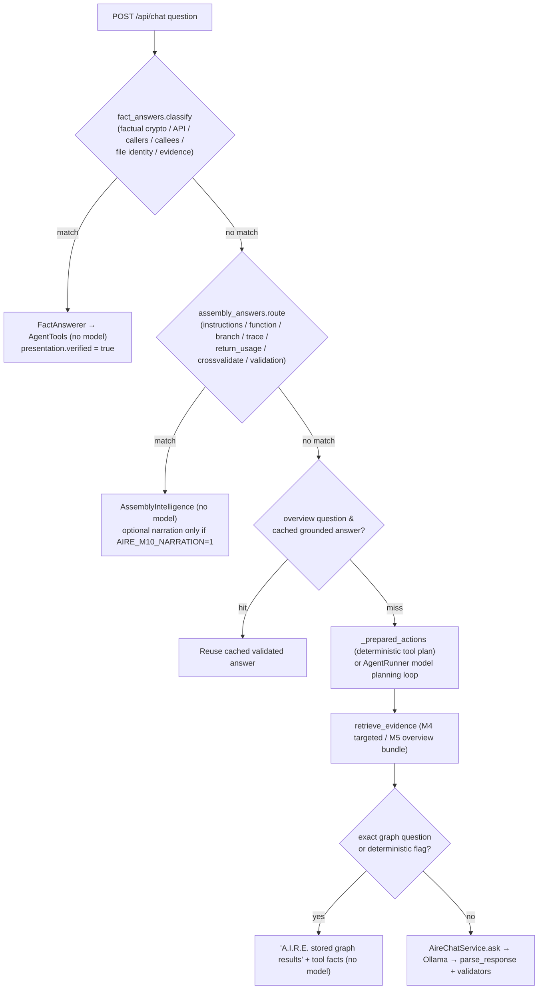
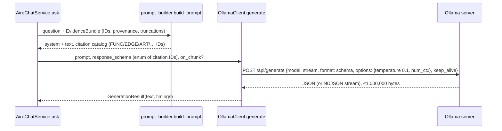
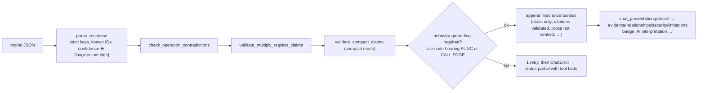

# A.I.R.E. system data flow

Audit date: **2026-11-19**. Branch `docs/aire-full-audit-2026-11-19`, based on
HEAD `ebacf4d`. Everything here comes from reading the live source in
`aire-server/src/aire/` and from the read-only probes described in
[TEST_VALIDATION_2026-11-19.md](TEST_VALIDATION_2026-11-19.md). File paths are
relative to `aire-server/src/aire/` unless stated otherwise. Line numbers were
correct at audit time. Use the symbol names if lines drift.

Each diagram is followed by a plain-text walkthrough of the same flow.

---

## 1. Components and trust boundaries



**Text walkthrough.** The browser loads static files from `api/static/` and
talks to one Python process, started by `aire gui` (`agent/cli.py:main`). Every
`/api/*` request goes through `AireRequestHandler` (`api/server.py:750`), which
checks the Host header, Origin/`Sec-Fetch-Site`, and a per-launch token.
`GuiApplication` (`api/server.py:241`) routes the request:

- intake goes to `BinaryLibrary`;
- tool and chat requests go to `BinaryWorkspace`/`AgentTools` and the
  answering layers;
- conversation state goes to `GuiSessionStore`.

Everything that reads analysis facts opens SQLite through `_ReadOnlyRuleStore`
(`security/rule_engine.py:135`), which uses a `mode=ro` URI plus
`PRAGMA query_only=ON`. Only the separate index-worker subprocess writes to the
database, and only through `BinaryKnowledgeStore.save_program_index`. Ollama
is reached only for model-backed chat paths. Deterministic paths never build a
model request.

**Trust boundaries.**

1. Untrusted binary bytes come in through upload or a fixture.
2. Binary-derived text (strings, names, decompiled C) is treated as data in
   prompts and HTML-escaped in the UI.
3. Model output is parsed against a strict schema and citation catalog. It
   never becomes a stored fact.
4. The target binary is never executed. Ghidra analyzes it statically in a
   throwaway project.

---

## 2. Binary ingestion and static analysis



**Text walkthrough.**

1. **Transfer.** `validateUpload()` (`static/app.js:812`) POSTs the raw file
   body to `/api/uploads`. The handler requires `application/octet-stream`,
   rejects chunked transfer encoding, and enforces
   `MAX_UPLOAD = 32 MiB` (`api/binary_library.py:26`). The socket timeout is
   30 s.
2. **Validation.** `BinaryLibrary.upload` (`api/binary_library.py:211`) does
   four things:
   - sanitizes the filename (display label only);
   - streams the body into a `.upload-*` temp file in the upload directory
     (`0700`);
   - calls `inspect_binary` (`:56`). That function checks real ELF header
     fields (class, data, version, type `ET_EXEC`/`ET_DYN`, program-header
     bounds). For `MZ` files it calls `validation/pe_structure.validate_pe`.
     File extensions are never trusted;
   - moves the file to `<upload-dir>/<sha256>/<filename>` with mode `0600`.

   PE damage that a loader can tolerate is accepted as `analysis_level:
   partial`. Header-level corruption is rejected with a structured report.
3. **Queueing.** `BinaryLibrary.start` (`:253`) does the following:
   - re-hashes the file;
   - refuses a SHA-256 change;
   - coalesces repeated clicks for the same hash;
   - limits the queue to 8 active jobs;
   - submits to a one-thread executor.

   `_run_analysis` (`:381`) sends one JSON line to a long-lived
   `python -m aire.api.index_worker <db>` subprocess and arms a watchdog
   (`AIRE_ANALYSIS_TIMEOUT`, default **3600 s**) that kills the worker if it
   hangs.
4. **Cache check.** `analysis/cache.analyze_binary` (`:74`) hashes the input,
   then reads only `analysis_metadata` (`load_analysis_metadata`). The cache
   hits only if `compatible_metadata` (`:59`) finds exact analyzer versions,
   the same Ghidra version, identical `IndexOptions`, instruction-IR version
   `1`, and reference-facts version `2`. The GUI worker passes
   `load_snapshot=False`, so a hit never loads full function bodies.
5. **Indexing.** `pyghidra/indexer.index_binary` (`:115`) works as follows:
   - **Setup.** It holds a process-wide lock and starts or reuses the
     JVM/PyGhidra (`_start_runtime`). It creates a *temporary* Ghidra project
     and imports the binary with `pyghidra.program_loader()`.
   - **Analysis.** It runs `pyghidra.analyze` (Ghidra auto-analysis).
   - **Extraction.** See the table below.
   - **Teardown.** It releases the program without saving and re-hashes the
     input. If the SHA-256 changed it raises `IndexingError`.

**What comes from Ghidra versus custom A.I.R.E. logic**

| Fact | Ghidra API used | A.I.R.E. logic on top |
|---|---|---|
| Functions, names, signatures, namespaces, calling conventions, thunk/external flags | `FunctionManager.getFunctions/getExternalFunctions` | Deterministic ordering (internal first, by address), stable IDs `"<sha256>:<address>"` |
| Decompiled C | `DecompInterface.decompileFunction(f, timeout_seconds, monitor)` | Pool of up to 4 decompiler instances (`AIRE_DECOMPILE_WORKERS`), one serial retry for timeouts, explicit `decompilation_incomplete` list |
| Assembly text + instruction/branch counts | `Listing.getInstructions` | Bounded to 200 instructions / 20,000 chars (`IndexOptions`), `assembly_truncated` flag |
| Basic blocks | `BasicBlockModel` | Count; with IR, block rows with successors |
| Structured instruction IR (M10) | Instruction operands, flow types, raw P-code (`PcodeOp.toString()`), block model, parameter storage | Parsed and normalized into compact JSON, zlib-compressed into `function_ir` (`pyghidra/instruction_ir.py`), capped at 4096 instructions per function |
| Strings, imports, exports | `Listing.getDefinedData` + `StringDataInstance`, `SymbolTable.getExternalSymbols`, `getExternalEntryPointIterator` | Artifact IDs = SHA-256 of `[kind,address,value]` |
| Direct CALL edges | `Instruction.getFlowType().isCall()` + `getReferencesFrom()` | Only resolved, non-computed call references to known function entries. Computed calls become warnings, never edges (`pyghidra/graph_builder.py:8`) |
| References / xrefs | `ReferenceManager.getReferenceSourceIterator` | Owner function, target function (only if not computed), linked artifact, ≤8 raw bytes at read targets |
| Thunk bindings | `Function.getThunkedFunction(False)` | Stored separately in `thunk_relations`. Never turned into CALL edges |
| ELF PIE flag / interpreter | Program memory blocks `.dynamic`, `.interp` | Custom decoding for ELF64 little-endian only |

Everything else is computed later from these stored facts. That includes
application relevance, cross-checks, semantics, CFG/loops, value flow, CWE
signals and crypto evidence. **Nothing is inferred by AI during indexing.**

---

## 3. SQLite persistence and retrieval



**Text walkthrough.** `BinaryKnowledgeStore` (`knowledge/database.py:170`)
owns the schema. The full column reference is in
[API_AND_DATA_REFERENCE.md §3](API_AND_DATA_REFERENCE.md#3-sqlite-schema).

- **Opening a store.** It turns on `PRAGMA foreign_keys`, creates schema v2 on
  an empty database, and upgrades v1 by adding the reference tables in one
  transaction.
- **Saving.** `save_program_index` (`:262`) deletes the binary's previous row,
  which cascades to its facts, and inserts every list in ordinal order inside
  one `BEGIN IMMEDIATE` transaction. Any failure rolls back the deletion as
  well.
- **The `function_ir` table** is created lazily, only when a snapshot carries
  IR.
- **Loading.** `load_program_index` reconstructs the snapshot. It checks
  ordinal contiguity, boolean values and foreign-key consistency, and raises
  `PersistedDataError` on corruption.

**Retrieval.** Retrieval never loads whole snapshots.
`ProgramQueryService` (`knowledge/retrieval.py:71`) runs SQL against one
snapshot transaction:

- exact selector resolution by ID, address or name, raising on ambiguous
  matches;
- callers (`get_callers`, `:152`, rows where `callee_function_id` is the
  target) and callees (`get_callees`, `:157`, rows where
  `caller_function_id` is the target);
- BFS reachability and shortest path (`find_call_path`, `:259`), with depth
  at most 64 (8 through the agent tool);
- connectivity ranking (`rank_functions`, `:297`).

Results are sorted numerically by address within an address space, so output
is deterministic regardless of row order.

**Persistent versus transient.** Persistent data is everything listed in
§2's table, plus analysis metadata (options, versions, timings, retry and
incomplete lists). Transient data is recomputed on demand and never written:
evidence bundles, relevance rankings, cross-checks, M10 semantics/CFG/flow,
CWE evaluations, crypto evidence, and every model output. GUI conversation
transcripts are stored separately, outside the analysis database.

---

## 4. Call-graph evidence



**Text walkthrough.** A CALL edge is stored as
`(caller_function_id, callee_function_id, callsite_address)`, where the
caller is the function *containing* the call instruction
(`graph_builder.py:16`). Answers are built as follows:

- **Callers** filter on `callee = target`. **Callees** filter on
  `caller = target`.
- **Rendering.** `FactAnswerer._graph` (`agent/fact_answers.py`) and
  `render_tool_facts` (`agent/runner.py:113`) print the edge as
  `caller → callee @ callsite`.
- **In the GUI,** the Call Graph panel (`showCallGraph`, `static/app.js:500`)
  reads `edge.caller.function` for the Callers section and
  `edge.callee.function` for the Callees section.
- **Direction check.** The audit probe compared tool output with raw SQL for
  `validate_input`, `process_input`, and the historically questioned
  `failwithmessage` in `FunctionOverloading.exe`. Direction matched in every
  case (see the test report).

**Limits.** Indirect/computed calls, callbacks and runtime-resolved targets
are not edges. They show up as indexing warnings
(`Indirect call at …; omitted`). Import thunks are separate bindings. A
missing edge never proves that a function is unreachable at runtime.

---

## 5. GUI ↔ backend API communication

```mermaid
sequenceDiagram
    participant B as Browser
    participant H as AireRequestHandler
    participant A as GuiApplication
    B->>H: GET /?token=… (printed at launch)
    H-->>B: 303 Location: / + Set-Cookie aire_token_<port> (HttpOnly; SameSite=Strict)
    B->>H: GET /api/bootstrap?binary_id=…
    H->>H: _trusted_request (Host exact, Sec-Fetch-Site, Origin) + _authorized (cookie/header)
    H->>A: bootstrap()
    A-->>B: binaries, metadata, sessions, tool names, model name
    B->>H: POST /api/sessions {binary_id}
    B->>H: POST /api/sessions/<id>/select-function {function}
    B->>H: POST /api/tool {session_id, tool, arguments}
    B->>H: POST /api/chat {session_id, question}
    H-->>B: NDJSON stream: event… text… context… result | error
```

**Text walkthrough.** Every important action follows the same path. Each
example names the user action, the frontend function, the HTTP request, the
backend handler, the service, the data source, and how the GUI renders the
result.

- **Select a binary.** `switchBinary()` (`app.js:886`) →
  `GET /api/bootstrap?binary_id=` → `GuiApplication.bootstrap` →
  `AgentTools.metadata` + `GuiSessionStore.list` → SQLite `binaries` and
  counts → `renderBinaryContext`.
- **Pick a function.** `showFunctions()` (`app.js:454`) →
  `POST /api/tool {tool:'list_functions'}`, then
  `POST /api/sessions/<id>/select-function` →
  `GuiApplication.select_function` → `get_function` tool → `functions` row →
  the session's `current_function_id` is saved → `updateSelectedFunction`.
- **Ask a question.** `sendQuestion()` (`app.js:314`) → `POST /api/chat` →
  `AireRequestHandler._chat` (`server.py:1001`), which acquires one of 4 chat
  slots or returns 429 → `GuiApplication.run_chat` (`server.py:404`) →
  routing (§6) → NDJSON records → `appendEvent`/`previewAnswer`/`renderAnswer`.
  The badge reads either *"Verified stored facts · deterministic · no AI
  model"* or *"AI interpretation · grounded in stored evidence, not verified
  fact"*.
- **Open the Function explorer.** `showExplorer()` (`app.js:573`) →
  `explorerTool` → `POST /api/tool` with `function_evidence`,
  `explain_instructions`, `function_cfg`, `branch_paths`, `trace_value`,
  `parameter_use`, `return_usage` or `crossvalidate_function` →
  `AssemblyIntelligence` (`analysis/assembly_intelligence.py:16`) →
  `function_ir` blob plus the `functions` row.
- **View findings or crypto.** `showFindings()`/`showCrypto()` →
  `security_findings` / `crypto_evidence` tools → `RuleEngine.scan_binary` /
  `crypto_evidence(db, …)`.
- **Check health.** `checkHealth()` (`app.js:901`) → `GET /api/health` →
  `OllamaClient.health()` (calls `/api/tags` only, never generation).

**Network assumptions.**

- **Default bind.** `127.0.0.1:8765`.
- **Non-loopback bind.** Requires `--allow-non-loopback-bind` and must be a
  single private IPv4 address (`_validate_bind_host`, `server.py:1035`). The
  token is mandatory in that mode.
- **Host header.** Must be exactly `localhost` or `127.0.0.1` on the bound
  port or `--public-port`.
- **POST requests.** Need a same-origin `Origin` header, or the
  `X-AIRE-Token` header for non-browser clients.
- **Split-host deployment.** For the Windows ↔ VM setup see the
  [root README](../README.md#running-aire-with-windows-host-inference). The
  Windows-side checks have not been verified in this audit.

---

## 6. Chatbot routing and agent tool execution



**Text walkthrough.** `GuiApplication.run_chat` (`api/server.py:404`) tries
three routes in order. The first match wins.

1. **Deterministic fact answers.** `GuiApplication._fact_answer` (`:505`)
   calls `agent/fact_answers.classify` (`:150`), a pure regex router. It
   claims only factual phrasings ("which/what/where/list/show/does …") about
   crypto operations, named APIs, imports, callers/callees, file identity or
   corruption, and "show the evidence". Evaluative words (why, how, explain,
   secure, vulnerable, …) are rejected so those questions fall through.
   `FactAnswerer` then calls the registered tools and returns Markdown with
   provenance. **Zero model requests.**
2. **M10 assembly answers.** `_assembly_answer` (`:575`) calls
   `agent/assembly_answers.route` (`:33`) for instruction explanations,
   "what does this function do", branch outcomes at an address, value
   tracing for a register or frame slot at an address, return-value usage,
   decompiler cross-validation, and binary-wide "where is input validated".
   These are answered from `AssemblyIntelligence`. Model narration is **off**
   unless `AIRE_M10_NARRATION=1`. When it is on, the narration runs in a
   bounded thread (`AIRE_M10_NARRATION_SECONDS`, default 60 s). Its cited
   addresses are checked by `validate_narration` (`:257`), and a narration
   that fails the check is rejected.
3. **Agent / model path.** Everything else goes here:
   - **Overview answers** ("what does this binary do") are cached per
     workspace. The cache key includes the relevance, cross-check and crypto
     policy versions, the model, `num_ctx` and the evidence budget.
   - **Deterministic plans.** `_prepared_actions` (`:687`) builds a fixed
     tool plan for overview, suspicious-behavior, crypto/hashing,
     important-functions and call-relationship questions.
   - **The agent loop.** `AgentRunner.run` (`agent/runner.py:267`) runs:
     1. a scope check;
     2. an optional overview preflight;
     3. exact symbol resolution from words in the question;
     4. regex routing for strings, xrefs and thunks;
     5. cross-checks for explain/compare questions;
     6. *only if nothing above routed the question*, a model planning loop
        (≤6 iterations, ≤8 tool calls, 180 s deadline, 12,000-character
        planning payload). The model's output must match a JSON schema
        derived from the tool catalog (`action_schema`) and is parsed
        strictly by `parse_action`.

     One tool slot is always reserved for the final `retrieve_evidence`.
     Exact graph questions (and the "suspicious behavior" / "call
     relationships" flags) skip model synthesis and return
     *"A.I.R.E. stored graph results"* plus deterministic tool facts.

**The tool registry.** `AgentTools` (`agent/tools.py:110`) registers **27**
tools:

- **18** listed in [M8_AGENT.md](M8_AGENT.md). These are the original M8 tools
  plus the October reference, thunk, classification, relevance and cross-check
  tools.
- **1** M9 tool: `crypto_evidence`.
- **8** M10 assembly-intelligence tools.

`ToolRegistry.run` (`:62`) does four things:

- rejects unknown tools;
- validates argument names, types, bounds and enums;
- converts exceptions into error objects;
- caps serialized results at 100,000 characters.

No tool writes to the store. The GUI store is read-only at the SQLite level.

---

## 7. Ollama inference



**Text walkthrough.** `OllamaClient` (`ai/ollama_client.py:50`) is configured
as follows:

- **Endpoint.** `AIRE_OLLAMA_HOST` (default `http://127.0.0.1:11434`).
  Literal loopback and `localhost` are accepted (`localhost` is pinned to
  `127.0.0.1`). IPv4-mapped IPv6 such as `[::ffff:127.0.0.1]` is
  **rejected**, as is any other host, unless `allow_remote_host=True`. The
  GUI's `--allow-remote-ollama` flag or `AIRE_OLLAMA_ALLOW_REMOTE=1` sets
  that option. The `aire chat` CLI never does.
- **Model.** `AIRE_OLLAMA_MODEL`. There is **no default model**:
  `generate` raises if none is set.
- **Context.** `AIRE_OLLAMA_NUM_CTX` (default 32768; the demo uses 4096).
- **Transport.** Proxies and redirects are disabled.
- **Timeouts.** The socket timeout defaults to 240 s. Inside the agent,
  `_DeadlineModel` shrinks it to the remaining agent deadline.

`AireChatService.ask` (`ai/chat.py:161`):

- builds the prompt from an evidence bundle;
- constrains the response grammar so that every `evidence_ids` entry must be
  an ID from the catalog;
- streams a provisional summary preview when possible;
- retries once with a format-correction note.

---

## 8. Response validation and presentation



**Text walkthrough.** `parse_response` (`ai/prompt_builder.py:295`) rejects:

- unknown or duplicate keys;
- evidence IDs that are not in the catalog;
- confidence values outside `low/medium/high`.

Post-checks then remove or reject interpretations that contradict
deterministic operation observations or name registers absent from the cited
assembly (`ai/chat.py:18`, `:52`, `:128`). Behavioral questions ("what does",
"why", "explain", overview) must cite code-bearing function evidence or a
stored CALL edge.

Fixed caveats are appended last, so model text cannot remove them:

- static evidence only, no execution or vulnerability confirmation;
- *citation existence is validated; prose is interpretation*;
- character bounds are not token counts.

If validation fails twice, the agent returns status `partial` with the
deterministic tool facts it already gathered. The audit reproduced this path
for "What does this binary do?" with an unavailable model.

`api/chat_presentation.present` (`:14`) turns the result into the
presentation object the GUI renders: a footer, evidence chips,
relationships, security items, limitations and raw data.

**Confidence is a three-level label chosen by the model and checked only for
membership in the allowed set. It is not a calibrated probability.**
